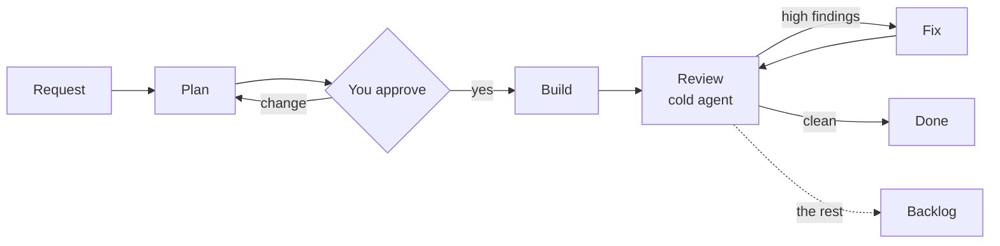

<p align="center">
  
</p>

<p align="center">
  <b>Build what you have in mind: an app, a document, a video, a game.</b><br>
  Your AI agent plans it, you approve, it builds, and a reviewer that never saw the work checks it.
</p>

<p align="center">
  <a href="https://www.npmjs.com/package/kaizen-agent"></a>
  <a href="https://github.com/hfadhlullah/kaizen/stargazers"></a>
  
  
  <a href="LICENSE"></a>
</p>

> **kaizen runs inside an AI agent; it is not one.** The agent does the work; kaizen gives it a plan, an approval stop and an independent review. It works with Claude Code, Codex, Antigravity and Gemini CLI, and the installer offers to set one up if you have none. A run costs several times a single prompt, so it is meant for work where being wrong is expensive. Windows support is in beta.

<br>

<p align="center">
  
</p>

<details>
<summary><b>What kaizen does</b>, as text</summary>

| | |
|---|---|
| **Any kind of work** | Each run works out what it is making (code, writing, communication, operations, research) and plans, builds and reviews it in those terms. Videos and decks go through the bundled `kaizen-motion`, `kaizen-video` (editing your own footage) and `kaizen-deck` skills. |
| **Plan first** | The agent writes what it will do, and what *wrong* would look like, then waits for your approve or change. |
| **A reviewer that starts cold** | A second agent reviews from the request, the plan and the diff only. It never saw the work, so it has nothing to defend. |
| **A fix loop that ends** | Serious findings are fixed and re-checked, at most twice. The rest come to you; what is left goes to a backlog. |
| **One board** | `kaizen web`: icebox, ideas, plan, build, review, fix, commit and push, in the browser or the terminal. |
| **Requests from where they live** | Sheets, docs and social posts are gathered into an icebox, grouped, and promoted to ideas when you pick them. |
| **A notebook agents read first** | An Obsidian-compatible vault under `.kaizen/notes/` that every stage reads before it plans or builds. |
| **On your phone** | The board installs as a PWA over Tailscale. `kaizen setup` prints the QR code. |
| **Any agent, any session** | Every stage is a file in `.kaizen/runs/<id>/`, so another session or another tool can pick a run up. |

</details>

<p align="center">
  
</p>

## The problem

You ask an AI coding agent to retry a payment webhook when the bank times out. It starts editing at once, then says *"Done, tests pass."* The tests do pass. They were written by the same agent, from the same assumption: that a timeout means the charge failed. Sometimes the bank said yes and the reply got lost. Now a retry charges the customer twice, and nothing in the agent's report would make you look.

None of this is a lack of intelligence. It is a missing workflow. Many assistants now ask before they act, and some check their own draft. The difference is *who* checks: a reviewer that shares the author's context shares its blind spots. Kaizen's reviewer starts cold, on purpose.

## Install

1. **Install** on macOS or Linux:
   ```bash
   curl -fsSL https://bun.sh/install | bash && ~/.bun/bin/bunx kaizen-agent
   ```
   On Windows (beta), in PowerShell:
   ```powershell
   irm bun.sh/install.ps1 | iex; & "$env:USERPROFILE\.bun\bin\bunx.exe" kaizen-agent
   ```
   Already have Bun? `bunx kaizen-agent`.
2. **Run `kaizen setup`.** It walks you through your project, settings, the board and the phone app.
3. **Open the board** with `kaizen web`, or type `/kaizen <request>` in your agent.

<p align="center">
  
</p>

## Requirements

| | |
|---|---|
| Runtime | [Bun](https://bun.sh) 1.1 or newer. The installer above gets it. |
| Agent | Claude Code, Codex, Antigravity or Gemini CLI. Claude Code gets the full flow with separate subagents; the others run every stage in one session. |
| Git | Needed for the board's commit and push. Optional otherwise. |
| OS | macOS, Linux. Windows in beta. |
| Phone app | [Tailscale](https://tailscale.com/download) on the PC and the phone, same account. |

## How it works



<p align="center">
  
</p>

Each stage is its own agent with a clean context: planner, builder, reviewer. They never share a context window. The main thread owns the run's state in `.kaizen/runs/<id>/state.json`; the plan, the build notes, the review and every fix round are files beside it. Small changes take a short path in one session, so a typo does not cost a payroll change.

## What kaizen changes on your machine

- Installs itself to `~/kaizen`, and keeps settings and the project list in `~/.kaizen/`.
- Links its skills, agents and `/kaizen-*` commands into each agent it finds: `~/.claude`, `~/.codex`, `~/.agents`, `~/.gemini`. Re-running is safe.
- Per project, `kaizen init` writes `.kaizen/` and, in a git repo, a `.gitignore` entry that keeps run state out of commits but keeps the `spec*.md` files and `config.yml`.
- `kaizen web` serves the board on `127.0.0.1:7420`. After `kaizen setup` it is also reachable from your own Tailscale network, nothing wider; never use `tailscale funnel`.
- `kaizen uninstall` removes the app and its links, and asks whether to keep your runs and settings (`--purge` deletes them too).

## Who it is for

**Good fit if you** build and maintain a product with an AI coding agent, have caught it confidently wrong more than once, and change things where a mistake is expensive: money, data, migrations, anything a customer sees.

**Not for you if** your changes are typos and one-liners, or you want the agent to ship without you. Kaizen is built to stop and ask.

## Phone app

The board is a PWA: installed from the browser, it opens full screen with the kaizen icon. It needs [Tailscale](https://tailscale.com/download) on this PC and on your phone, both signed in to the same account.

```bash
kaizen setup        # guided: starts the board, runs tailscale serve, prints a QR code
```

Scan the QR code with your phone camera, then **Add to Home screen** (iOS: Share menu; Android: browser menu, *Install app*).

By hand: run `kaizen web`, then `tailscale serve --bg 127.0.0.1:7420`, add `<pc>.<tailnet>.ts.net` to `~/.kaizen/web-hosts`, and open `https://<pc>.<tailnet>.ts.net` on the phone. Details in [docs/guide.md](docs/guide.md#in-a-browser). Never use `tailscale funnel` — it publishes the board to the internet.

To add a launcher (Spotlight on macOS, the app menu on Linux, a Desktop shortcut on Windows), run `kaizen web --shortcut` once.

## Development

TypeScript on Bun, zero runtime dependencies. No build step for the CLI.

```bash
git clone https://github.com/hfadhlullah/kaizen.git && cd kaizen
bun install && bun test
bun run cli/install.ts    # install from this checkout
```

### Layout

| Path | What it is |
|---|---|
| `cli/` | The installer and the runtime behind every `kaizen` command: `install.ts` (the CLI), `state.ts` (runs), `web.ts` (board server), `dashboard.ts` (terminal board), `sources.ts`, `settings.ts`, `notes.ts`. Tests beside them. |
| `skills/` | The workflow as Agent Skills folders: `kaizen/` (`SKILL.md`, the `spec-*.md` stage contracts, `adapters.md`, `config.default.yml`), `kaizen-help/`, and `media/` with `kaizen-deck/`, `kaizen-video/`, `kaizen-motion/`. |
| `agents/` | The Claude Code subagents: `kaizen-planner`, `kaizen-builder`, `kaizen-reviewer`. |
| `commands/` | The `/kaizen-*` slash commands, one file each. |
| `web/` | The board and notebook front end: `board.html`, `notes.html`, `notebook.ts`. |
| `bot/` | Kaizen Bot — a separate private package with its own tests and build. See [its README](bot/README.md). |
| `docs/` | The guide and internal notes, indexed in [`docs/README.md`](docs/README.md). |
| `design.md` | Design notes for the repo. |
| `.kaizen/` | This repo's own runs — kaizen is built with kaizen. Gitignored: a fresh clone gets it on its first run. |

Kaizen Bot: [bot/README.md](bot/README.md). Other docs: [docs/README.md](docs/README.md). Pull requests welcome; CI runs `bun test` on Ubuntu and Windows and it must pass. For non-trivial work, dogfood: `/kaizen <change>` in this repo plans, builds and reviews it — [`skills/kaizen/spec.md`](skills/kaizen/spec.md) is the contract the stages follow.

## What you can make

<p align="center">
  
</p>

## License

kaizen is licensed under the [MIT License](LICENSE).

<p>
  <a href="https://github.com/hfadhlullah"></a>
  &nbsp;Built by <a href="https://github.com/hfadhlullah"><b>Husein Fadhlullah</b></a>, with kaizen.
</p>

<sub>kaizen is not affiliated with Anthropic, OpenAI or Google. Claude Code, Codex, Antigravity and Gemini CLI are trademarks of their owners.</sub>
